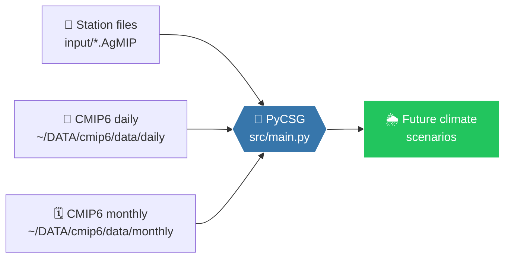

<div align="center">

# 🌍 PyCSG 🌦️

### Climate scenarios for your weather stations, powered by CMIP6


**[🚀 Quick Start](#-quick-start)** •
**[📂 Data Layout](#-data-layout)** •
**[🎛️ Options](#️-command-line-options)** •
**[🧪 Examples](#-examples)** •
**[❓ FAQ](#-faq)**

</div>

---

## ✨ What is PyCSG?

**PyCSG** takes your **station weather files** (AgMIP format) and combines them with **CMIP6 climate model output** to produce **future climate scenarios** for the time slices you choose: near, mid and end of century.

| 🎯 You pick | 🧩 PyCSG handles |
|---|---|
| 📍 Stations | Reading AgMIP weather files |
| 🌐 Climate models | Reading CMIP6 daily / monthly data |
| 🔥 SSP scenarios | Combining historical + future data |
| ⏳ Time periods | Writing scenario outputs |

---

## 🚀 Quick Start

### 1️⃣ Clone the repo

```bash
git clone https://github.com/goikelem/PyCSG.git
cd PyCSG
```

### 2️⃣ Prepare your CMIP6 data

Place your data under `~/DATA/cmip6/data` (see [Data Layout](#-data-layout)).

### 3️⃣ Run it!

```bash
python src/main.py --stations ETAD0QXX.AgMIP --models access_cm2 --scenarios ssp126 --periods near mid end
```

🎉 That's it. PyCSG will process the station for the `access_cm2` model under `ssp126` for the near, mid and end periods.

---

## 📂 Data Layout

<details open>
<summary><b>🗂️ CMIP6 data (click to collapse)</b></summary>

```text
~/DATA/cmip6/data
├── 📅 daily
│   ├── historical
│   ├── ssp1_2_6
│   ├── ssp2_4_5
│   ├── ssp3_7_0
│   ├── ssp4_6_0
│   └── ssp5_8_5
└── 🗓️ monthly
    ├── historical
    ├── ssp1_2_6
    ├── ssp2_4_5
    ├── ssp3_7_0
    ├── ssp4_6_0
    └── ssp5_8_5
```

</details>

<details open>
<summary><b>📍 Station input files (click to collapse)</b></summary>

```text
PyCSG/input
├── ETAD0QXX.AgMIP
├── ETDE0QXX.AgMIP
├── ETKO0QXX.AgMIP
└── ETRO0QXX.AgMIP
```

Each `.AgMIP` file is one weather station. Pass the file name to `--stations`.

</details>

---

## 🎛️ Command-Line Options

| Flag | 🏷️ Meaning | 💡 Example |
|---|---|---|
| `--stations` | 📍 One or more station files from `input/` | `ETAD0QXX.AgMIP` |
| `--models` | 🌐 CMIP6 climate model(s) | `access_cm2` |
| `--scenarios` | 🔥 Emission scenario(s) | `ssp126` |
| `--periods` | ⏳ Future time slice(s) | `near mid end` |

### 🔥 Scenario cheat-sheet

| Flag value | Folder | Pathway | Vibe |
|---|---|---|---|
| `ssp126` | `ssp1_2_6` | SSP1-2.6 | 🟢 Sustainability |
| `ssp245` | `ssp2_4_5` | SSP2-4.5 | 🟡 Middle of the road |
| `ssp370` | `ssp3_7_0` | SSP3-7.0 | 🟠 Regional rivalry |
| `ssp460` | `ssp4_6_0` | SSP4-6.0 | 🟠 Inequality |
| `ssp585` | `ssp5_8_5` | SSP5-8.5 | 🔴 Fossil-fuelled development |

### ⏳ Periods

| Flag | Meaning |
|---|---|
| `near` | 🌱 Near future |
| `mid` | 🌿 Mid century |
| `end` | 🌳 End of century |

---

## 🧪 Examples

<details>
<summary><b>🔹 One station, one model, one scenario</b></summary>

```bash
python src/main.py --stations ETAD0QXX.AgMIP --models access_cm2 --scenarios ssp126 --periods near mid end
```

</details>

<details>
<summary><b>🔹 Multiple stations</b></summary>

```bash
python src/main.py --stations ETAD0QXX.AgMIP ETDE0QXX.AgMIP ETKO0QXX.AgMIP ETRO0QXX.AgMIP --models access_cm2 --scenarios ssp126 --periods near mid end
```

</details>

<details>
<summary><b>🔹 Multiple scenarios</b></summary>

```bash
python src/main.py --stations ETAD0QXX.AgMIP --models access_cm2 --scenarios ssp126 ssp245 ssp585 --periods mid end
```

</details>

<details>
<summary><b>🔹 Only the end of the century</b></summary>

```bash
python src/main.py --stations ETKO0QXX.AgMIP --models access_cm2 --scenarios ssp585 --periods end
```

</details>

---

## 🔄 Workflow at a Glance



---

## 🛠️ Installation

```bash
git clone https://github.com/goikelem/PyCSG.git
cd PyCSG
python -m venv .venv
source .venv/bin/activate        # Windows: .venv\Scripts\activate
pip install -r requirements.txt  # if provided
```

---

## ❓ FAQ

<details>
<summary><b>Where should I put my CMIP6 files?</b></summary>

Under `~/DATA/cmip6/data/{daily,monthly}/<experiment>/`, where `<experiment>` is `historical` or one of the `ssp*` folders.

</details>

<details>
<summary><b>How do I add my own station?</b></summary>

Drop your AgMIP weather file into `PyCSG/input/` and pass its name to `--stations`.

</details>

<details>
<summary><b>Can I run several models at once?</b></summary>

Yes, list them after `--models`, separated by spaces.

</details>

---

## 🤝 Contributing

Contributions are welcome! 💚

1. 🍴 Fork the repo
2. 🌿 Create a branch: `git checkout -b feature/awesome`
3. 💾 Commit: `git commit -m "Add awesome feature"`
4. 📤 Push: `git push origin feature/awesome`
5. 🔃 Open a Pull Request

---

<div align="center">

Made with 💙 by [@goikelem](https://github.com/goikelem)

⭐ **If PyCSG helps your research, give it a star!** ⭐

</div>
